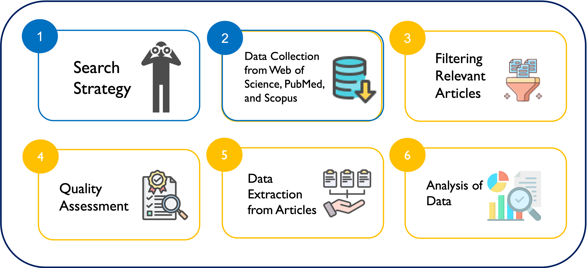

# systematic_review

## Methodology Overview

This study follows the Preferred Reporting Items for Systematic Reviews and Meta-Analyses (PRISMA) guidelines and applies a hybrid, scalable pipeline that combines manual curation, information retrieval techniques, and large language models (LLMs).

### Literature Search and Preprocessing
We conducted exploratory and expert-informed searches across PubMed, Web of Science, and Scopus. Retrieved records were enriched with metadata using the public PubMed API. Automated preprocessing steps were applied to remove duplicate records and non-English abstracts.

### Relevance Screening
Abstract-level relevance screening was performed using GPT-4o-mini to identify studies addressing barriers to nursing research participation and the implementation of evidence-based practice. Review articles were excluded based on combined abstract- and full-text analysis.

### Quality Appraisal
Methodological quality was assessed using the Mixed Methods Appraisal Tool (MMAT). Two independent LLMs conducted the appraisal, while a third model resolved disagreements, ensuring consistency and reducing model-specific bias.

### Barrier and Solution Extraction
Full-text articles were analyzed using GPT-4o-mini to extract explicit barriers and proposed solutions. Extracted items underwent an iterative, model-driven consolidation process to form non-redundant thematic categories. This process resulted in ten barrier categories and eight solution categories.
